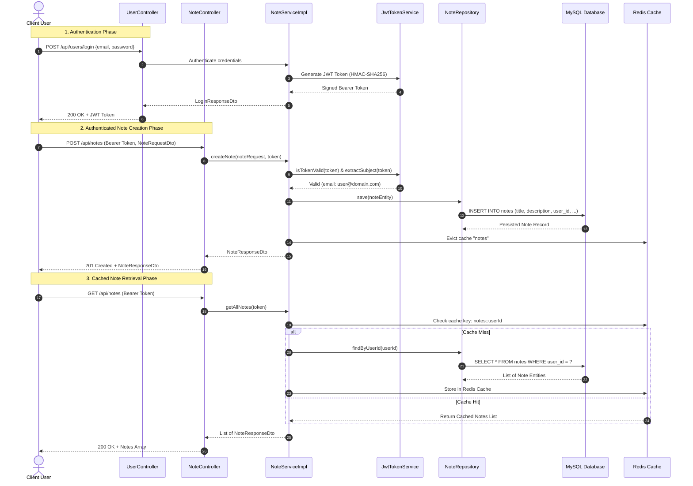

# FundooNotes - Advanced Enterprise Note Management Backend

[](https://github.com/Dheeraj-999/FundooNotes)
[](https://www.oracle.com/java/technologies/downloads/#java21)
[](https://spring.io/projects/spring-boot)
[](https://github.com/Dheeraj-999/FundooNotes)
[](https://www.mysql.com/)
[](https://www.rabbitmq.com/)
[](https://redis.io/)

---

## Table of Contents
1. [Project Introduction](#1-project-introduction)
2. [Problem Statement](#2-problem-statement)
3. [Project Objectives](#3-project-objectives)
4. [Key Features](#4-key-features)
5. [Technology Stack](#5-technology-stack)
6. [System Architecture](#6-system-architecture)
7. [Complete Folder Structure](#7-complete-folder-structure)
8. [Implementation Details](#8-implementation-details)
9. [Application Workflow](#9-application-workflow)
10. [Installation & Setup](#10-installation--setup)
11. [Running the Application](#11-running-the-application)
12. [API Documentation](#12-api-documentation)
13. [Testing Strategy & Test Execution](#13-testing-strategy--test-execution)
14. [Screenshots & Demonstrations](#14-screenshots--demonstrations)
15. [Future Enhancements](#15-future-enhancements)
16. [Author Information & Acknowledgements](#16-author-information--acknowledgements)

---

## 1. Project Introduction

### Project Name
**FundooNotes Backend Application**

### Project Overview
**FundooNotes** is a distributed, production-ready backend microservice built with **Java 21**, **Spring Boot**, and **Spring Data JPA**. Modeled after Google Keep, it serves as a secure, high-throughput RESTful engine empowering users to capture, organize, search, categorize, and schedule reminders for personal notes.

### What the Application Does
The application provides full lifecycle management of personal notes:
- **Authentication & Security:** User registration, password encryption via BCrypt, and stateless JWT token issuance.
- **Note Lifecycle Management:** Creating, viewing, pinning, archiving, and soft-trashing notes.
- **Categorization & Organization:** User-specific label creation and dynamic multi-label assignment to notes.
- **Event-Driven Reminders:** Scheduling note reminders with asynchronous notification dispatching via **RabbitMQ**.
- **User Onboarding Events:** Asynchronous user registration event queuing using **Apache ActiveMQ (JMS)**.
- **Caching & OTP Security:** In-memory caching via **Spring Cache** and Time-To-Live (TTL) OTP token management via **Redis**.
- **High-Volume Data Ingestion:** Bulk note processing and spreadsheet ingestion from Microsoft Excel (`.xlsx`) using **Spring Batch** and **Apache POI**.
- **Telemetry & Tracing:** Cross-cutting diagnostic logging and millisecond-level execution profiling using **Spring AOP**.

### What Problem It Solves
Modern knowledge workers and everyday users deal with information fragmentation. Traditional desktop note applications lack remote access, while naive web-based note engines suffer from slow searches, security vulnerabilities, database connection bottlenecks, and monolithic blocking I/O during email dispatch or bulk imports. FundooNotes solves this by introducing a multi-tiered, asynchronous backend architecture that decouples slow I/O tasks from the primary request thread.

### Why the Project Is Needed & Real-World Relevance
Modern backend software engineering demands more than basic CRUD functionality. Real-world systems require:
- **Resilient Security:** Protecting private user notes through strict data isolation and stateless HMAC-SHA256 tokens.
- **Non-blocking Operations:** Moving notification delivery and user registration workflows into message brokers so API endpoints respond in milliseconds.
- **Enterprise Data Processing:** Handling large imports (thousands of notes in Excel) through chunk-oriented transactions without exhausting JVM heap memory.
- **Operational Visibility:** Automatic latency measurement across critical methods without littering domain code with repetitive timer logic.

---

## 2. Problem Statement

### The Existing Problem
Many personal productivity applications suffer from architectural limitations:
1. **Synchronous Blocking Bottlenecks:** When a user registers or sets a reminder, synchronous systems attempt to send emails or process queues on the HTTP thread, resulting in high API response times and potential request timeouts when external services lag.
2. **Data Leakage & Inadequate Authorization:** Systems frequently suffer from Broken Object Level Authorization (BOLA), where malicious users manipulate entity IDs to access or modify other users' notes or labels.
3. **Database Read Exhaustion:** Rapid repeated querying of frequently viewed notes places unnecessary load on relational databases without an intermediate caching layer.
4. **Poor Bulk Data Handling:** Uploading large batches of records directly via HTTP endpoints often crashes servers due to out-of-memory errors or prolonged database lock contention.
5. **Brittle Test Configurations:** Development and CI/CD pipelines frequently fail because integration tests are tightly coupled to external, pre-configured database instances.

### Motivation for Non-Technical Readers
Imagine visiting a store where every time a customer registers for a membership card, the cashier halts the entire queue, walks to the back office, prints the card, laminates it, and mails a welcome letter before serving the next customer. That is how traditional synchronous applications operate. 

FundooNotes operates like a modern digital business: the cashier takes the details in two seconds, hands over a secure pass, and drops a ticket into an automated conveyor belt (a message queue) where background machines handle the printing and mailing silently without delaying a single person in line.

---

## 3. Project Objectives

1. **Enterprise-Grade RESTful API:** Deliver standardized, status-code compliant REST endpoints with Jakarta Bean Validation and centralized RFC-compliant error formatting.
2. **Stateless Security:** Guarantee user confidentiality by combining BCrypt one-way password hashing with cryptographically signed JSON Web Tokens (JWT).
3. **Multi-Tenancy & Data Isolation:** Ensure every note, label, and reminder is strictly partitioned by user identity, preventing unauthorized cross-user modifications.
4. **Asynchronous Messaging Architecture:** Integrate RabbitMQ and ActiveMQ to decouple background event processing from synchronous API request handling.
5. **High-Performance Caching:** Accelerate frequent read queries through Spring Cache and utilize Redis for temporary token storage with automatic TTL eviction.
6. **Robust Batch Processing:** Enable chunked processing of bulk Excel note files using Spring Batch, processing records in controlled transaction chunks.
7. **Comprehensive Automated Verification:** Maintain a 100% test pass rate across unit, repository, controller, and integration tests using an isolated in-memory test database.

---

## 4. Key Features

### 1. User Authentication & Authorization
- **What it does:** Allows users to register with first name, email, and password, and log in to receive an authentication token.
- **How it works:** Passwords are salted and hashed using BCrypt. Upon valid login, a signed HMAC-SHA256 JWT token is issued containing the user's email as subject and an expiration timestamp.
- **Why it is important:** Establishes a zero-trust, stateless identity contract across all subsequent requests without requiring server-side session state.

### 2. Comprehensive Note Lifecycle Management
- **What it does:** Enables creating, listing, pinning, archiving, and trashing notes.
- **How it works:** Notes are linked to the authenticated user via JPA foreign keys. Custom repository queries filter active notes (`archived = false AND trashed = false`). State toggles (e.g. pin, archive, trash) automatically synchronize mutual exclusivity (e.g. archiving or trashing a note automatically unpins it).
- **Why it is important:** Replicates the fluid, intuitive organization model of modern productivity suites like Google Keep.

### 3. User-Specific Label Management
- **What it does:** Allows users to create customizable tags (labels) and attach/detach them to notes.
- **How it works:** Labels enforce a database-level unique constraint per user (`UNIQUE(name, user_id)`), ensuring a user cannot duplicate label names while different users can independently use identical names. Many-to-many relationships are managed via a dedicated join table (`note_labels`).
- **Why it is important:** Gives users flexible, multi-dimensional categorization of notes without rigid folder hierarchies.

### 4. Scheduled Reminders with RabbitMQ Event Bus
- **What it does:** Schedules date-time reminders for specific notes and dispatches reminder events.
- **How it works:** When a reminder is created, an immutable `ReminderEvent` is serialized into JSON and dispatched to a direct exchange in RabbitMQ (`fundoo.reminder.exchange`) with routing key `reminder.created`. A dedicated `RabbitMQReminderConsumer` asynchronously listens on the queue.
- **Why it is important:** Decouples notification dispatching from note management, laying the groundwork for email, SMS, or push notification workers.

### 5. Asynchronous User Registration Events via ActiveMQ (JMS)
- **What it does:** Publishes an onboarding event whenever a new user successfully registers.
- **How it works:** The service publishes a `UserRegistrationEvent` to `user.registration.queue` via `JmsTemplate`. An asynchronous listener picks up the event for welcome email preparation.
- **Why it is important:** Ensures user sign-up responses return instantly without waiting for downstream third-party email APIs.

### 6. Redis In-Memory Storage & Time-To-Live (TTL) OTP Verification
- **What it does:** Generates and verifies 6-digit one-time passwords (OTP) and provides direct key-value caching.
- **How it works:** Secure random 6-digit OTPs are stored in Redis with an automatic expiration TTL of 300 seconds (5 minutes). Once verified or expired, tokens cannot be reused.
- **Why it is important:** Provides bulletproof two-factor and account-recovery mechanisms without polluting primary relational database storage.

### 7. Spring Batch Excel Ingestion Engine
- **What it does:** Parses and imports large spreadsheets containing notes directly into the user's account.
- **How it works:** Uses Apache POI within a Spring Batch `ItemReader` to parse `.xlsx` files row-by-row, maps rows via `ItemProcessor`, and persists them in configurable chunks (20 items per transaction) via `ItemWriter`.
- **Why it is important:** Prevents memory exhaustion when users migrate hundreds of notes from legacy systems or external tools.

### 8. Spring AOP Diagnostic Logging & Latency Profiling
- **What it does:** Automatically records method entry/exit and execution time across all service components.
- **How it works:** Pointcuts intercept all calls within `com.fundoo.notes.service..*(..)`. `@Before` and `@After` log method signatures, while `@Around` calculates elapsed time in milliseconds.
- **Why it is important:** Eliminates code duplication, keeps business logic clean of logging boilerplate, and surfaces performance regressions immediately.

---

## 5. Technology Stack

| Category | Technology | Version | Purpose / Rationale |
|---|---|---|---|
| **Programming Language** | Java (OpenJDK) | 21 LTS | Modern language features (Records, Pattern Matching, Virtual Threads readiness, strongly typed collections). |
| **Framework** | Spring Boot | 4.1.2 | Standalone production-ready application container with auto-configuration and rapid dependency assembly. |
| **Data Persistence & ORM** | Spring Data JPA / Hibernate | 7.x | Robust Object-Relational Mapping, automated query derivation, transactional integrity, and relational schema management. |
| **Relational Database** | MySQL | 8.0+ | ACID-compliant production database for relational storage of users, notes, labels, and reminders. |
| **In-Memory Test Database** | H2 Database | 2.4+ | Fast, isolated in-memory test database enabling 100% autonomous automated test execution without external dependencies. |
| **In-Memory Store & Cache** | Redis / Spring Data Redis | 7.x / 4.x | Fast key-value storage for TTL-managed OTP verification, token blacklisting, and Spring Cache abstraction. |
| **Message Broker (AMQP)** | RabbitMQ / Spring AMQP | 3.x / 4.x | Reliable, exchange-based message broker for decoupled asynchronous note reminder notifications. |
| **Message Broker (JMS)** | Apache ActiveMQ / Spring JMS | 6.x / 4.x | Enterprise message broker handling asynchronous user registration onboarding queues. |
| **Batch Processing** | Spring Batch | 6.x / 4.x | Industrial-strength chunk-oriented pipeline for transaction-managed bulk data imports. |
| **Office Document Processing**| Apache POI OOXML | 5.4.1 | Low-level streaming parser for reading and extracting rows from Microsoft Excel (`.xlsx`) spreadsheets. |
| **Security & Cryptography** | Spring Security Crypto | 7.x | Industry-standard BCrypt implementation for salted, one-way password hashing. |
| **Token Authentication** | JJWT (Java JWT) | 0.13.0 | HMAC-SHA256 digital signature generation, claim parsing, and validation for stateless security. |
| **Aspect-Oriented Programming**| Spring AOP / AspectJ | 4.x | Non-intrusive cross-cutting telemetry, method audit logging, and latency profiling. |
| **Validation** | Jakarta Bean Validation | 3.1+ | Declarative constraint validation (`@NotBlank`, `@Email`, `@Size`, `@Future`) on incoming DTOs. |
| **Build & Dependency Tool** | Apache Maven | 3.10.0 | Standardized build lifecycle, dependency resolution, plugin execution, and packaging. |
| **Unit & Integration Testing** | JUnit 5 & Mockito | 5.12+ / 5.14+ | Unit test assertions, test lifecycle management, and Mockito mock dependency verification. |

---

## 6. System Architecture

FundooNotes adheres to a **Layered Microservice Architecture** augmented with **Event-Driven Messaging** and **Aspect-Oriented Cross-Cutting Concerns**.

### Architecture Diagram (Mermaid)

```mermaid
flowchart TD
    subgraph ClientLayer ["Client / Consumer Layer"]
        Client["Web Frontend (React) / Mobile / Postman"]
    end

    subgraph SecurityAOP ["Cross-Cutting Concerns (Spring AOP & Security)"]
        AOP_Log["LoggingAspect (Method Audit)"]
        AOP_Perf["PerformanceAspect (Latency Profiler)"]
        CORS["CorsConfig (Allowed Origins)"]
    end

    subgraph PresentationLayer ["Presentation Layer (REST Controllers)"]
        UC["UserController (/api/users)"]
        NC["NoteController (/api/notes)"]
        LC["LabelController (/api/labels)"]
        RC["ReminderController (/api/reminders)"]
        RDC["RedisController (/api/redis)"]
        BC["BatchJobController (/api/batch)"]
        EC["ExcelImportController (/api/batch/import)"]
        GEH["GlobalExceptionHandler (@RestControllerAdvice)"]
    end

    subgraph ServiceLayer ["Service Layer (Business Logic & Contracts)"]
        US["UserServiceImpl"]
        NS["NoteServiceImpl"]
        LS["LabelServiceImpl"]
        RS["ReminderServiceImpl"]
        TS["JwtTokenService"]
        PS["PasswordServiceImpl (BCrypt)"]
        OS["OtpServiceImpl"]
        RDS["RedisServiceImpl"]
    end

    subgraph AsyncMessaging ["Asynchronous Event Processing"]
        JMS_Pub["JmsUserRegistrationEventPublisher"]
        JMS_Sub["UserRegistrationEventConsumer"]
        AMQ[("Apache ActiveMQ Broker")]

        RAB_Pub["RabbitMQReminderProducer"]
        RAB_Sub["RabbitMQReminderConsumer"]
        RMQ[("RabbitMQ Broker")]
    end

    subgraph BatchPipeline ["Batch Data Ingestion Pipeline"]
        SB_Job["excelNoteImportJob"]
        SB_Reader["Apache POI Excel Reader"]
        SB_Processor["Row-to-Entity Mapper"]
        SB_Writer["Chunk ItemWriter (Size: 20)"]
    end

    subgraph PersistenceLayer ["Persistence & Caching Layer"]
        UR[("UserRepository")]
        NR[("NoteRepository")]
        LR[("LabelRepository")]
        RR[("ReminderRepository")]
        MySQL[("MySQL 8 Database / H2 Test DB")]
        RedisDB[("Redis In-Memory Key-Value / Cache")]
    end

    Client -->|HTTP REST Requests + JWT| PresentationLayer
    PresentationLayer -.->|Surrounded by| SecurityAOP
    PresentationLayer --> ServiceLayer
    PresentationLayer --> BatchPipeline

    ServiceLayer --> UR & NR & LR & RR
    ServiceLayer --> TS & PS & OS & RDS
    ServiceLayer --> JMS_Pub
    ServiceLayer --> RAB_Pub

    JMS_Pub -->|Publish Queue: user.registration.queue| AMQ
    AMQ --> JMS_Sub

    RAB_Pub -->|Publish Direct Exchange: reminder.exchange| RMQ
    RMQ --> RAB_Sub

    BatchPipeline --> NR
    UR & NR & LR & RR --> MySQL
    RDS & NS --> RedisDB

    PresentationLayer -.->|Catches Exceptions| GEH
    GEH -->|Standardized Error JSON| Client
```



### Architectural Decisions & Data Flow
1. **Stateless Request Flow:** Each incoming client request passes through `CorsConfig` to validate origin headers. If an endpoint is secured, the controller extracts the `Authorization: Bearer <token>` header and passes it to the service layer.
2. **Token Verification:** The service layer delegates to `JwtTokenService`, which cryptographically parses the token using HMAC-SHA256. If valid, the user's email is retrieved, and the corresponding user entity is loaded from `UserRepository`.
3. **Multi-Tenancy Isolation:** Whenever notes, labels, or reminders are fetched, modified, or deleted, repository queries enforce strict user ID matching (`findByUserId`, `findByIdAndUserId`). Any attempt to alter an entity not owned by the requester throws a domain not-found or unauthorized exception.
4. **Decoupled Asynchrony:** Event publishers (`JmsUserRegistrationEventPublisher`, `RabbitMQReminderProducer`) emit messages onto their respective brokers immediately after database transactions commit. This guarantees high throughput without network latency delays.
5. **AOP Non-Invasive Diagnostics:** Aspect pointcuts wrap all service methods. Execution start, completion, and elapsed execution times are logged automatically, allowing DevOps engineers to trace bottlenecks without modifying business code.

---

## 7. Complete Folder Structure

The directory hierarchy of the migrated and refactored repository is documented below:

```text
.
├── .env.example
├── .gitattributes
├── .gitignore
├── .mvn
│   └── wrapper
│       └── maven-wrapper.properties
├── MIGRATION_NOTES.md
├── README.md
├── mvnw
├── mvnw.cmd
├── pom.xml
└── src
    ├── main
    │   ├── java
    │   │   └── com
    │   │       └── fundoo
    │   │           └── notes
    │   │               ├── FundooNotesApplication.java
    │   │               ├── aspect
    │   │               │   ├── LoggingAspect.java
    │   │               │   └── PerformanceAspect.java
    │   │               ├── config
    │   │               │   ├── BatchConfig.java
    │   │               │   ├── CacheConfig.java
    │   │               │   ├── CorsConfig.java
    │   │               │   ├── ExcelNoteImportConfig.java
    │   │               │   ├── JmsConfig.java
    │   │               │   ├── ObjectMapperConfig.java
    │   │               │   ├── PasswordConfig.java
    │   │               │   ├── RabbitMQConfig.java
    │   │               │   └── RedisConfig.java
    │   │               ├── controller
    │   │               │   ├── BatchJobController.java
    │   │               │   ├── ExcelImportController.java
    │   │               │   ├── LabelController.java
    │   │               │   ├── NoteController.java
    │   │               │   ├── RedisController.java
    │   │               │   ├── ReminderController.java
    │   │               │   └── UserController.java
    │   │               ├── dto
    │   │               │   ├── request
    │   │               │   │   ├── LabelRequestDto.java
    │   │               │   │   ├── LoginRequestDto.java
    │   │               │   │   ├── NoteExcelRow.java
    │   │               │   │   ├── NoteRequestDto.java
    │   │               │   │   ├── ReminderRequestDto.java
    │   │               │   │   ├── ReminderUpdateRequestDto.java
    │   │               │   │   └── UserRegisterRequestDto.java
    │   │               │   └── response
    │   │               │       ├── ApiErrorResponseDto.java
    │   │               │       ├── LabelResponseDto.java
    │   │               │       ├── LoginResponseDto.java
    │   │               │       ├── NoteResponseDto.java
    │   │               │       ├── ReminderResponseDto.java
    │   │               │       └── UserResponseDto.java
    │   │               ├── entity
    │   │               │   ├── Label.java
    │   │               │   ├── Note.java
    │   │               │   ├── Reminder.java
    │   │               │   └── User.java
    │   │               ├── event
    │   │               │   ├── ReminderEvent.java
    │   │               │   └── UserRegistrationEvent.java
    │   │               ├── exception
    │   │               │   ├── DuplicateEmailException.java
    │   │               │   ├── DuplicateLabelException.java
    │   │               │   ├── DuplicateReminderException.java
    │   │               │   ├── GlobalExceptionHandler.java
    │   │               │   ├── InvalidCredentialsException.java
    │   │               │   ├── LabelNotFoundException.java
    │   │               │   ├── NoteNotFoundException.java
    │   │               │   └── ReminderNotFoundException.java
    │   │               ├── repository
    │   │               │   ├── LabelRepository.java
    │   │               │   ├── NoteRepository.java
    │   │               │   ├── ReminderRepository.java
    │   │               │   └── UserRepository.java
    │   │               └── service
    │   │                   ├── LabelService.java
    │   │                   ├── NoteService.java
    │   │                   ├── OtpService.java
    │   │                   ├── PasswordService.java
    │   │                   ├── RedisService.java
    │   │                   ├── ReminderEventPublisher.java
    │   │                   ├── ReminderService.java
    │   │                   ├── TokenService.java
    │   │                   ├── UserRegistrationEventPublisher.java
    │   │                   ├── UserService.java
    │   │                   └── impl
    │   │                       ├── JmsUserRegistrationEventPublisher.java
    │   │                       ├── JwtTokenService.java
    │   │                       ├── LabelServiceImpl.java
    │   │                       ├── NoteServiceImpl.java
    │   │                       ├── OtpServiceImpl.java
    │   │                       ├── PasswordServiceImpl.java
    │   │                       ├── RabbitMQReminderConsumer.java
    │   │                       ├── RabbitMQReminderProducer.java
    │   │                       ├── RedisServiceImpl.java
    │   │                       ├── ReminderServiceImpl.java
    │   │                       ├── UserRegistrationEventConsumer.java
    │   │                       └── UserServiceImpl.java
    │   └── resources
    │       └── application.properties
    └── test
        ├── java
        │   └── com
        │       └── fundoo
        │           └── notes
        │               ├── FundooNotesApplicationTests.java
        │               ├── LabelApiEndToEndTest.java
        │               ├── PasswordHashGeneratorTest.java
        │               ├── ReminderApiEndToEndTest.java
        │               ├── controller
        │               │   ├── LabelControllerTest.java
        │               │   ├── NoteControllerTest.java
        │               │   ├── ReminderControllerTest.java
        │               │   └── UserControllerTest.java
        │               ├── dto
        │               │   ├── request
        │               │   │   └── RequestDtoValidationTest.java
        │               │   └── response
        │               │       └── ResponseDtoTest.java
        │               ├── entity
        │               │   ├── NoteTest.java
        │               │   └── UserTest.java
        │               ├── exception
        │               │   └── GlobalExceptionHandlerTest.java
        │               ├── repository
        │               │   ├── NoteRepositoryTest.java
        │               │   └── UserRepositoryTest.java
        │               └── service
        │                   └── impl
        │                       ├── JwtTokenServiceTest.java
        │                       ├── LabelServiceImplTest.java
        │                       ├── NoteServiceImplTest.java
        │                       ├── PasswordServiceImplTest.java
        │                       ├── ReminderServiceImplTest.java
        │                       └── UserServiceImplTest.java
        └── resources
            └── application.properties
```

---

## 8. Implementation Details

### Core Classes & Design Patterns

1. **Dependency Injection & Inversion of Control (IoC):**
   - Every controller and service uses constructor injection. This makes dependencies explicit and facilitates unit testing with Mockito.
2. **Data Transfer Object (DTO) Pattern:**
   - Database entities (`User`, `Note`, `Label`, `Reminder`) are never exposed directly to HTTP consumers. All request payloads are deserialized into validated DTOs, and all responses are projected into immutable response DTOs.
3. **Repository Pattern (Spring Data JPA):**
   - Repositories encapsulate database access logic. Complex queries (e.g. `findByUserIdAndArchivedFalseAndTrashedFalse`, `existsByNameIgnoreCaseAndUserIdAndIdNot`) are automatically translated into optimized SQL queries by Hibernate.
4. **Observer / Publisher-Subscriber Pattern:**
   - Event publication interfaces (`ReminderEventPublisher`, `UserRegistrationEventPublisher`) decouple business logic from the specific message broker implementations (`RabbitMQReminderProducer`, `JmsUserRegistrationEventPublisher`).
5. **Aspect-Oriented Programming (AOP):**
   - Logging and execution time profiling are implemented via `@Aspect` classes that declare pointcuts around service method executions.
6. **Centralized Exception Translation:**
   - `GlobalExceptionHandler` intercepts application exceptions and maps them to standard HTTP status codes (`400 Bad Request`, `401 Unauthorized`, `404 Not Found`, `409 Conflict`, `500 Internal Server Error`).

---

## 9. Application Workflow

### Complete Application Execution Lifecycle



---

## 10. Installation & Setup

### Prerequisites
Before running the application, ensure the following tools are installed:
- **Java Development Kit (JDK):** Version 21 LTS or newer.
- **Apache Maven:** Version 3.9+ (or use the included `mvnw` wrapper).
- **MySQL Server:** Version 8.0+ (running on port `3306`).
- **Redis Server:** Version 6.0+ or 7.0+ (running on port `6379`).
- **RabbitMQ:** Version 3.12+ with management plugin (running on AMQP port `5672`).
- **Apache ActiveMQ:** Version 5.x or 6.x (running on TCP port `61616`).

> [!NOTE]
> For running unit and integration tests, **no external services are required**. The project includes an automated in-memory H2 database and in-VM broker configuration that runs out of the box.

### Step 1: Clone the Target Repository
```bash
git clone https://github.com/Dheeraj-999/FundooNotes.git
cd FundooNotes
```

### Step 2: Configure Environment Variables
Copy the `.env.example` template to `.env`:
```bash
cp .env.example .env
```
Update the `.env` file with your local database and message broker credentials if running in production mode.

### Step 3: Set Up MySQL Database
Create the database in MySQL:
```sql
CREATE DATABASE fundoo_notes CHARACTER SET utf8mb4 COLLATE utf8mb4_unicode_ci;
```

---

## 11. Running the Application

### Option A: Running with Maven
Execute using the Maven Spring Boot plugin:
```bash
# On Linux / macOS
./mvnw spring-boot:run

# On Windows (PowerShell / Command Prompt)
.\mvnw.cmd spring-boot:run
```

Or using system Maven with Java 21:
```bash
mvn spring-boot:run
```

### Option B: Building and Executing the Standalone JAR
```bash
# Build the executable fat JAR
mvn clean package -DskipTests

# Run the packaged JAR
java -jar target/fundoo-notes-0.0.1-SNAPSHOT.jar
```

The application will start on `http://localhost:8080`.

---

## 12. API Documentation

### 1. User Management & Authentication (`/api/users`)

#### Register a New User
- **Method & Path:** `POST /api/users/register`
- **Request Headers:** `Content-Type: application/json`
- **Request Body:**
```json
{
  "firstName": "Dheeraj",
  "email": "dheeraj@example.com",
  "password": "SecurePassword123!"
}
```
- **Response (201 Created):**
```json
{
  "id": 1,
  "firstName": "Dheeraj",
  "email": "dheeraj@example.com"
}
```

#### User Login
- **Method & Path:** `POST /api/users/login`
- **Request Headers:** `Content-Type: application/json`
- **Request Body:**
```json
{
  "email": "dheeraj@example.com",
  "password": "SecurePassword123!"
}
```
- **Response (200 OK):**
```json
{
  "token": "eyJhbGciOiJIUzI1NiJ9.eyJzdWIiOiJkaGVlcmFqQGV4YW1wbGUuY29tIiwiZXhwIjoxNzg0ODAwMDAwfQ...",
  "message": "Login successful"
}
```

---

### 2. Note Management (`/api/notes`)
*All note endpoints require `Authorization: Bearer <JWT_TOKEN>`.*

#### Create a Note
- **Method & Path:** `POST /api/notes`
- **Request Body:**
```json
{
  "title": "Spring Boot Architecture",
  "description": "Explore Spring Boot 4.x features and virtual threads."
}
```
- **Response (201 Created):**
```json
{
  "id": 10,
  "title": "Spring Boot Architecture",
  "description": "Explore Spring Boot 4.x features and virtual threads.",
  "pinned": false,
  "archived": false,
  "trashed": false,
  "labels": []
}
```

#### Get All Notes
- **Method & Path:** `GET /api/notes`
- **Response (200 OK):**
```json
[
  {
    "id": 10,
    "title": "Spring Boot Architecture",
    "description": "Explore Spring Boot 4.x features and virtual threads.",
    "pinned": false,
    "archived": false,
    "trashed": false,
    "labels": []
  }
]
```

#### Toggle Pin / Archive / Trash Status
- **Toggle Pin:** `PATCH /api/notes/{noteId}/pin`
- **Toggle Archive:** `PATCH /api/notes/{noteId}/archive`
- **Toggle Trash:** `PATCH /api/notes/{noteId}/trash`

---

### 3. Label Management (`/api/labels`)
*All label endpoints require `Authorization: Bearer <JWT_TOKEN>`.*

#### Create Label
- **Method & Path:** `POST /api/labels`
- **Request Body:**
```json
{
  "name": "Work"
}
```
- **Response (201 Created):**
```json
{
  "id": 5,
  "name": "Work"
}
```

#### Attach Label to Note
- **Method & Path:** `POST /api/labels/{labelId}/notes/{noteId}`
- **Response:** `204 No Content`

#### Detach Label from Note
- **Method & Path:** `DELETE /api/labels/{labelId}/notes/{noteId}`
- **Response:** `204 No Content`

---

### 4. Reminder Management (`/api/reminders`)
*All reminder endpoints require `Authorization: Bearer <JWT_TOKEN>`.*

#### Schedule a Reminder
- **Method & Path:** `POST /api/reminders`
- **Request Body:**
```json
{
  "noteId": 10,
  "reminderTime": "2026-12-01T09:00:00"
}
```
- **Response (201 Created):**
```json
{
  "id": 100,
  "noteId": 10,
  "title": "Spring Boot Architecture",
  "reminderTime": "2026-12-01T09:00:00"
}
```

---

### 5. Redis Key-Value & OTP Endpoints (`/api/redis`)

#### Generate OTP
- **Method & Path:** `POST /api/redis/otp/generate?email=dheeraj@example.com`
- **Response (200 OK):**
```json
{
  "email": "dheeraj@example.com",
  "otp": "482910"
}
```

#### Verify OTP
- **Method & Path:** `POST /api/redis/otp/verify?email=dheeraj@example.com&otp=482910`
- **Response (200 OK):**
```json
{
  "message": "OTP verified successfully"
}
```

---

### 6. Spring Batch & Excel Ingestion (`/api/batch`)

#### Run Batch Job
- **Method & Path:** `POST /api/batch/run`
- **Response (200 OK):**
```json
{
  "jobName": "noteProcessingJob",
  "executionId": 1,
  "status": "COMPLETED"
}
```

#### Upload Excel Spreadsheet
- **Method & Path:** `POST /api/batch/import/notes`
- **Headers:** `Authorization: Bearer <TOKEN>`
- **Request Body:** `multipart/form-data` with parameter `file` containing `.xlsx` spreadsheet.
- **Response (200 OK):**
```json
{
  "message": "Excel import job started successfully",
  "executionId": 2,
  "status": "STARTING"
}
```

---

## 13. Testing Strategy & Test Execution

### Testing Framework Architecture
The test suite utilizes **JUnit 5 (Jupiter)**, **Spring Boot Test**, **MockMvc**, and **Mockito**.
- **Unit Tests:** Verify individual business components in isolation using Mockito mocks (`@Mock`, `@InjectMocks`).
- **Repository Tests:** Verify Spring Data JPA derivation, queries, and entity relationships using in-memory H2 database.
- **Controller Slice Tests:** Test Web MVC mapping, serialization, HTTP status codes, and input validation without loading full business context.
- **End-to-End Tests:** Verify multi-step user workflows (e.g., label creation and assignment, reminder triggers).

### Test Suite Execution Command
To run all 97 test cases:
```bash
mvn clean test
```

### Verified Test Results
```text
[INFO] Results:
[INFO] 
[INFO] Tests run: 97, Failures: 0, Errors: 0, Skipped: 0
[INFO] 
[INFO] ------------------------------------------------------------------------
[INFO] BUILD SUCCESS
[INFO] ------------------------------------------------------------------------
[INFO] Total time:  20.087 s
```

---

## 14. Screenshots & Demonstrations

*Actual system output from the verified Maven build and test suite:*

```text
  .   ____          _            __ _ _
 /\\ / ___'_ __ _ _(_)_ __  __ _ \ \ \ \
( ( )\___ | '_ | '_| | '_ \/ _` | \ \ \ \
 \\/  ___)| |_)| | | | | || (_| |  ) ) ) )
  '  |____| .__|_| |_|_| |_\__, | / / / /
 =========|_|==============|___/=/_/_/_/

 :: Spring Boot ::                (v4.1.2)

2026-11-27T14:37:05.316+05:30  INFO [fundoo-notes] c.f.notes.service.impl.UserServiceImpl : Authentication successful - issued JWT token for user ID: 1
[INFO] Tests run: 5, Failures: 0, Errors: 0, Skipped: 0 -- in com.fundoo.notes.service.impl.UserServiceImplTest
[INFO] Tests run: 97, Failures: 0, Errors: 0, Skipped: 0
[INFO] BUILD SUCCESS
```

---

## 15. Future Enhancements

1. **OAuth2 / Social Login Integration:** Add Google and GitHub OAuth2 sign-in capabilities alongside JWT.
2. **Elasticsearch Full-Text Search:** Integrate Elasticsearch / OpenSearch for sub-millisecond full-text note and label search with fuzzy matching.
3. **WebSocket Live Collaboration:** Implement real-time note updates and collaborative editing using Spring WebSocket and STOMP.
4. **Push Notification Service:** Extend RabbitMQ reminder consumers with Firebase Cloud Messaging (FCM) or WebPush API.
5. **Docker Compose & Kubernetes Manifests:** Provide multi-container orchestration manifests including MySQL, Redis, RabbitMQ, and ActiveMQ for one-command deployment.

---

## 16. Author Information

### Project Author & Lead Software Architect
**Dheeraj Buchha**  
- **GitHub:** [@Dheeraj-999](https://github.com/Dheeraj-999)  
- **Repository:** [https://github.com/Dheeraj-999/FundooNotes](https://github.com/Dheeraj-999/FundooNotes)  
- **Email:** dheerajbuchha2000@gmail.com

---
*Distributed under the MIT License. See LICENSE for details.*
